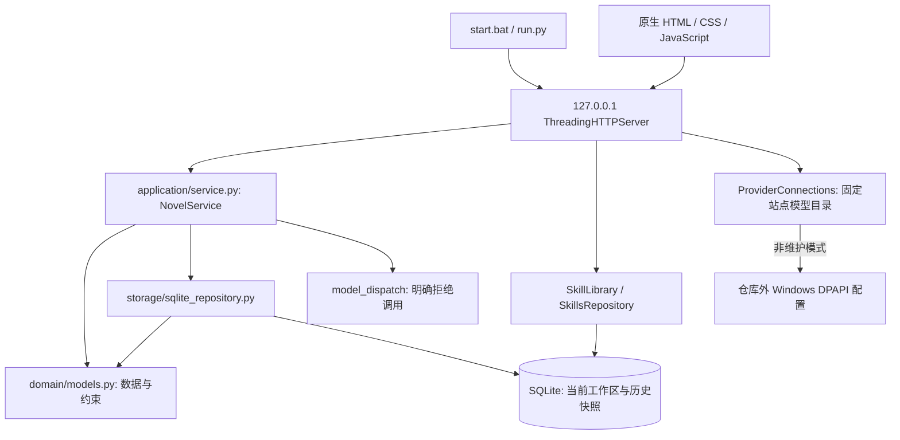
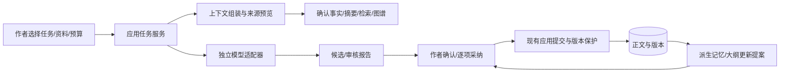

# 架构现状与演进设计

## S2-C当前技术收口（2026-10-15）

本次已有库迁移/复制架构与三表/schema/B新目录恢复语义保持。独立Astra仅修改`storage/backup_validation.py`、`tests/test_migrations.py`、`tests/test_backup_validation.py`：恢复integrity_check专用错误分类，外层优先重抛进度回调保存的原取消异常；强杀worker显式导入src、独立白名单环境、持久PID/编号/窗口/模块路径握手，提前退出也收集真实双流/退出码并关闭PIPE，保留并加强全表/历史/来源保护。新增1项真实SQLite完整性指令中一次性取消边界，修改前与修改后均通过。

4定向、B headless8组/C7组、完整278 Python/6 Node/示例均退出0，129文件检查期间不变、diff0、credential_hints空。原项目检查脚本未改；仓库外`hidden_core.py`通过runpy转发原入口，仅为子进程隐藏控制台，实际argv留痕，不宣称无shim运行；PowerShell路径仅补在本轮子进程PATH。故障注入外层0及内层故意失败用于核对提前退出不会冒充强杀成功。

新领导`01a13b4a-0b47-7100-93fa-0a13b8fa6752`接任，旧领导已交权停派；Sol统一独立执行、必要独立Astra、执行链仍无法处理的网络/安全测试才DeepSeek，不用子代理/重复建聊天。Astra已停止三个项目文件写入并交回领导，Sol当前仅同步文档，无新业务改动或复测。作者体验验收、正式服务投用及整体S2仍未完成，D/章节/草稿余项仅后续建议，不进入D/S3。[统一交付与原始证据](docs/s2-c-migration.md)。

## 历史：S2-C原实现与回归阻碍（Sol交接时，2026-10-15）

`application/migrations.py`复用B冻结/严格预检，在可信新暂存库转换全历史联合ID，再在目标同连接BEGIN IMMEDIATE锁内校验并事务插入三表。`storage/backup_validation.py`抽取共享`validate_connection`供锁内使用，保持可信schema/全历史/资源检查；当前抽取引入B完整性读取错误分类回归，完整core未通过，必须收口。

`ui/migration_routes.py`复用BackupTransfers的两槽、关闭与流式上传，server新增独立迁移能力/导入/复制/状态/取消路由；app只扩展已有历史模块，未改首页布局。库外`.novel-migration-operations-<目标命名空间>`收据保存身份/映射/预期hash，不含正文/密钥，不进包、不新增业务表。预检只写控制收据，提交后按真实SQL核对幂等；旧JSON的初始快照/占位默认明确报告。

专项24业务/7 HTTP及C/B受影响headless通过；完整277 Python方法存在2失败方法（3条failure）及1错误方法，本轮3次修复已用完，等待领导派独立Astra处理错误分类、强杀夹具环境/pipe及runner路径。schema和B新目录语义保持，正式服务未加载新代码，C/作者验收/整体S2未完成。[完整交付与证据](docs/s2-c-migration.md)。下方旧轮状态保留历史。

## S2-B显式中断恢复收口（2026-10-14）

旧Sol新增`application/backup_staging_recovery.py`：真实创建暂存时在独立authority登记原目录/marker/lock身份及receipt哈希，DPAPI保护新生成HMAC材料；清理写入prepared、根删除及逐元数据删除意图，per-operation OS锁串行核对。CLI只接受明确原目录/恢复目录及原UUID；原根仍在时只归还原元数据，原根有可信删除意图且已缺失时仅完成登记元数据/空恢复目录清理，终态记录保留幂等。无自动扫描、归属补发或未知内容清理。

当前Sol仅修复`_private_root`的SDDL字面差异：完整SID描述符及实际读回均经同一Win32渲染函数（OWNER|DACL=5）规范化再严格比较；owner当前用户、protected DACL及仅本用户/SYSTEM完全访问契约保持，不启用特权或重写既有ACL。新增负例以真实新建目录解除DACL保护并断言前提，不改生产校验或跳过断言。

DeepSeek完成第三轮专项39方法、5个真实恢复强杀窗口及随后完整core 246 Python/6 Node/示例，各退出码0；失败历史、hash和原始日志见[统一交付](docs/s2-b-staging-recovery.md)。core准备时缺Git仅在子进程PATH解决，业务/测试持续冻结；本轮未重跑浏览器，正式8765未更新或操作，作者验收未完成。

authority固定在`tempfile.gettempdir()/AI-Novel-Writer-staging-authority-v1`，TEMP变化/被清理会限制旧操作定位；已有根缺key失败关闭，不能重签或收编，旧残留未清理。信任当前用户和authority，不抵抗同用户任意代码执行；物理断电、网络盘/跨平台、>4GiB及百万字规模未验证。只完成这一项S2-B技术收口，整体S2、S2-C及其余阶段未完成，正式库/真实凭据未碰、无提交推送。

以下均保留各轮历史状态及数字；此前“元数据移出窗口未验证”以本节限定的5个真实强杀窗口结果更新，不推广为任意断电或自动恢复能力。

## S2-B暂存清理追加（2026-10-14）

`backup_staging.OwnedTemporaryDirectory`以mkdtemp和不引用self的weakref.finalize替代stdlib路径递归finalizer，正常cleanup/退出/GC均保存创建时完整收据和原OS锁流，通过固定原对象清理；失败先释放锁且不自动重试。显式inspect/cleanup仍只接受明确原目录和对应操作编号，不按名称或PID扫删。

`_remove_pinned`枚举/固定/删除payload期间根和子对象拒绝写入/替换。两份元数据最后处理；payload已全部处理后，保留原marker固定句柄及父目录固定句柄，仅终末切换根句柄，并再次核对原目录身份。同父临时恢复目录`.novel-staging-recovery-<operation_id>-<随机值>`暂存原元数据，通过原DELETE句柄、固定目录句柄和native相对名称移动，拒绝覆盖；根删除失败补偿移回，保持原receipt字节/锁inode。成功根删除是提交点，后续恢复目录删除失败只给残留警告，业务已发布结果保留。版本V1、包格式、事务及恢复发布策略不变。

补偿受到同名新内容/权限/磁盘阻碍，或元数据移出窗口进程中断时，可能保留原根和恢复目录。错误报告明确恢复位置，不伪造替代锁、不覆盖新内容；现有inspect-staging只核对原路径，未实现恢复目录自动发现/重建，也未验证该窄窗口强杀/断电。19项暂存、真实junction探针及其他证据见[追加交付](docs/s2-b-staging-cleanup.md)；正式服务和作者验收状态保持。

## 本轮收口与开发工具（2026-10-14）

`LocalServer`的备份关闭标记与惰性创建使用同一`_backups_lock`：关闭先发生时拒绝首次创建；已有管理器在监听关闭前设取消事件，锁外关闭监听/清理。关闭后仍可检查既有已关闭管理器，不能创建新的活动传输区。下载出口控制BackupError/断开响应，不在二进制响应后追加JSON。真实HTTP补齐请求头的两个失败反例及最终14项上传回归见[接管报告](docs/dev-takeover-2026-10-14.md)。现有备份格式、SQLite事务与数据版本没有修改。

开发设施独立于小说应用：`Invoke-DevWorkflow.ps1`定位已安装运行时并只读记录监听者，首层Python通过ProcessStartInfo环境白名单及Windows参数转义启动；`dev_workflow.py`负责OS检查锁/仓库外唯一报告/Git候选hash和敏感提示/白名单子进程/复用既有回归。hash和扫描读取前共用checked_path检查原路径及解析后保护路径。不会加载业务数据库或调用模型，不接入应用路由。任务规划、最多3轮根因修复、文档与阶段判断由当前执行代理依据AGENTS/TASKS及任务模板完成，脚本只报告选定检查结果。工具边界和未启用机制见[工作流说明](docs/dev-workflow.md)。

## S2-B上传等待修复（2026-10-14）
独立验收P2的根因是BufferedReader.read(size)凑满数据期间无法执行deadline/取消检查。`ui/backup_routes.py::_receive_upload`在原HTTP请求线程内临时设置socket非阻塞，先以read1消费头部预读的正文；空读后以select等待可读，最长100ms并取总/空闲剩余预算最小值。非阻塞首次空读不能判EOF，可读后再次空读才拒绝截断；实际收到字节只刷新20秒空闲期限，不刷新300秒总deadline。等候及数据处理前检查取消/服务关闭，不引入接收或看门狗线程，也不重试已被socket timeout污染的缓冲读取。
finally恢复原socket模式；断开导致恢复模式失败也不阻止外层清理上传暂存、活动操作和恢复槽。失败关闭该请求连接，`server.py::handle_backup`吞掉对已断开连接的响应写入错误，保留原业务错误/事务/收据/无覆盖发布。12个真实HTTP用例包含滴流、静默、EOF/RST、缓冲正文、正常分片、双槽隔离和关闭/写失败，见[修复证据与限制](docs/s2-b-upload-p2-fix.md)。这是上传正文等待修复，不是通用HTTP头部防护或新后台任务系统；取消仍遵循“发布已完成就报告完成”。

## S2-B 已实现结构（2026-10-14）
当前已实现完整库V1备份与独立恢复，文档见[交付及限制](docs/s2-b-acceptance.md)。三种数据版本/profile不变，不拆表或自动迁移。下列早期“正式备份尚未实现”保留其当时范围，已有库合并/迁移仍是方案。

| 新模块/变化 | 责任 |
|---|---|
| application/backups.py | mode=ro源+SQLite backup一致采集，冻结快照生成manifest，流式包/完整预检、单事务新库保真重建、关连接重开SQL hash验证、同卷无覆盖发布；发布后清理警告区别失败 |
| storage/backup_validation.py + schema_v1.json | 应用可信DDL/schema profile，三表所有列/索引/外键/触发器、SQL元信息与所有revision/嵌套引用严格校验；资源限额取回前检测 |
| storage/json_codec.py + sqlite_repository.py + domain/models.py | 有界严格解析；create/get/save接入全历史校验，实体version按首现revision上下文递归查引用；领域层不依赖storage |
| application/backup_identity.py | 库外不可变恢复收据绑定操作UUID/包hash/期望SQL hash；先留存后恢复，同包重试与响应丢失/重启核对，拒绝已编辑目标 |
| ui/backup_routes.py + server.py | 本机token/Origin保护、受控新目标与流式上传/原生下载；两并发槽含下载、四传输文件配额、取消及能力端点，懒加载不在普通启动建临时区 |
| ui/static/app.js | 历史模块完整备份/新目录恢复/核对与取消；只存非秘密operation UUID，旧运行后端能力不足时禁用新控件；Skills原文随页面填入不重复请求 |
| scripts/manage_backups.py / validate_s2_b.py | 无外部模型的明确路径CLI；只虚构库、白名单非秘密环境、仓库外证据的完整回归入口 |

完整业务数据仍仅三表；恢复收据是库外控制状态，不加入SQL业务schema，也不进备份。包始终排除DPAPI配置、环境/token和作者未保存输入，SHA256不认证来源、包未加密。新目录恢复保留原ID/时间/原SQL TEXT；当前工作台不热切换，已存在目标拒绝，不把不兼容输入静默改为V1。资源上限和未验收性能/断电/强杀/跨平台边界见交付。

2026-10-14更新：S2-A仅数据审计/格式设计/虚构样本交付，生产架构和三种数据版本未变；正式备份、恢复、迁移及生产预检尚未实现，待作者验收后另行授权。以下更早实现记录保留其当时边界。

日期：2026-10-14。状态：S1工作台及作者追加的对话中心UI已实现；S2-A设计待验收，S2正式业务及S3–S7仍为待实施方案。UI规格/证据见[docs/chat-workbench.md](docs/chat-workbench.md)。需求编号见[PRODUCT_REQUIREMENTS.md](PRODUCT_REQUIREMENTS.md)，阶段见[ROADMAP.md](ROADMAP.md)。

本轮状态复核见 [当前状态与S2计划](docs/current-state-and-s2-plan.md)：源码及临时服务UI验收通过。后续作者明确授权的 [运行修复](docs/runtime-service-fix.md) 已安全重启同一原库、实际验收8765设置页。新增 `run.py --offline` 传至 LocalServer/ProviderConnections；维护模式不调用环境密钥检查/DPAPI加载，`connections`三站点的`key_configured=null`表示未知，配置保存/连接检查前后端拒绝，生成继续禁用。普通启动行为保留。以下S2设计未实施，先完整备份/恢复/迁移，再按规模证据决定存储演进。

## 1. 已实现的结构

| 层/入口 | 实际职责与边界 |
|---|---|
| `run.py`、`start.bat` | 参数、Python 环境、数据库路径、端口、浏览器打开与关闭 |
| `domain/models.py` | dataclass、稳定字符串 ID、UTC 时间、类型/归属/版本链校验；不依赖业务/UI/存储 |
| `application/service.py` | 分派操作、业务确认与 revision 检查；组合现有独立模块 |
| `application/chapters.py`、`versions.py` | 手动正文保存、正式章节授权、追加版本与恢复新草稿 |
| `storage/json_codec.py` | schema_version=1 JSON 读取/转换，拒绝未知版本/字段和非法关联 |
| `storage/sqlite_repository.py` | `projects` 中存完整 JSON；每次事务同时追加 `project_snapshots`；保护旧版本和快照 |
| `storage/skills_repository.py` | 独立 `skills` 表保存 Markdown 原文；不安装/执行资料 |
| `ui/server.py` | HTTP 和静态资源，Host/Origin/写入 token 校验，CSP，无 CORS，仅本机 |
| `ui/static/app.js` | 工作区/文档导航、业务事件、资料/历史/命令协调；本机请求期间防重复操作 |
| `ui/static/api.js` | 原 HTTP 契约、内存 token、错误状态；不调用供应商 |
| `ui/static/state.js` | 按实体内存草稿/revision 与有预算上限的只读行差异；独立 PromptStore 存项目隔离的未发送需求与引用 |
| `ui/static/views.js` | 原有编辑表单、HTML 转义、textarea.value 原文注入；业务动作未替换 |
| `ui/static/layout.js` | 受限 UI 偏好、主题、宽度/收起、专注、抽屉焦点和调整通知 |
| `ui/static/index.html`、`style.css` | 默认近黑对话首页、固定 composer、可折叠模块与页签；真实编辑/资料/任务区按需打开，明暗与窄屏 |

当前核心数据：`NovelDocument` 内有项目、大纲、人物、章节、细纲与版本；分卷、场景和人物关系已有领域结构但无完整可用编辑入口。工作区外包一层 IDEA、世界观文本、文风文本和 revision。

版本边界分别为 `schema_version=1`（小说 JSON）、`workspace_version=1`（工作区）、`PRAGMA user_version=1`（数据库）。三者含义独立，后续不能只升级一个字段就认为迁移完成。

## 2. 已知限制与依据

1. **窗口状态与异步演进。** S1 已拆出 API/状态/布局/视图，支持按实体草稿与多标签；仍在短本地请求期间全局防重复操作，文档切换重建当前表单。S4 的长模型任务须另建任务设施，不能沿用全局 busy 阻断作者写作。S1 草稿不落盘，关闭/刷新后没有恢复能力。
2. **当前规模边界。** S1 有章节树/标题筛选、可折叠布局和独立固定保存区；100 章已加载导航通过四尺寸与 <300ms 测量。当前没有分卷编辑/归档/重排，测量不等于百万字数据库性能或 Electron 验收。
3. **存储增长。** 当前工作区已含所有正文历史，每次保存再复制到项目快照。更新一个章节仍读取、验证、序列化整本书并返回全状态；没有百万字/多历史基准，不能据此承诺长篇性能。
4. **备份范围不完整。** JSON 导出只调用 `service.get()`，不是完整数据库备份；没有导入业务入口。项目快照和独立 Skills 不在该导出中。
5. **任务设施未建立。** HTTP 操作是同步短请求，未实现流式输出、可取消后台任务、费用记录、任务恢复、候选与人工审核状态。
6. **AI 数据契约尚不支持。** `VersionRecord.source` 目前只允许 `manual`，实体字段与解析器严格拒绝未知字段；不能直接往旧 payload 塞候选、记忆或模型元数据。
7. **服务不是公开后端。** 本机 token 与来源检查已存在，不能开放为互联网服务或删除这些检查来适配桌面。当前库没有全文加密。

## 3. 渐进演进决策

| 决策 | 选择与原因 | 替代方案与退出条件 |
|---|---|---|
| D01 保留业务核心 | 沿用 Python、SQLite、领域与业务边界；已有 91 项回归可保护作者数据 | 全部改 Node/云后端会重做保护；仅在有量化瓶颈且兼容迁移完成时另评审 |
| D02 UI 先改结构 | S1 用原生 ES 模块、CSS Grid、样式变量拆分职责，保留 textarea 和 HTTP 契约 | 框架/富文本编辑器后续按多标签复杂度和中文编辑性能评估，本次不选库不安装 |
| D03 长篇存储先测量 | S2 同夹具测旧实现，然后增量引入实体/版本表；旧读取兼容及复制迁移 | 继续整书 JSON 可用于小规模过渡，若未验证收益不强制换存储；不能靠删历史达标 |
| D04 检索逐层增加 | S3 本地关键词/SQLite FTS 能力探测与降级；S5 再评估向量/混合检索 | 避免一开始引入专用向量库/图数据库；依据检索验收和项目规模决定 |
| D05 AI 与 UI 分离 | 适配器→任务服务→候选/审核→人工提交；一次请求不直接写正式章 | 不把 SDK 放 UI 或领域层；后续新模型通过适配契约扩展 |
| D06 Electron 包装现有系统 | S7 Electron 管理 Python 子进程，复用工作台与应用服务；优先 Windows | 全部迁移 Electron/Node 业务无必要；具体传输桥接需通过安全原型验收 |

D01 的现有业务核心及 D02 的 S1 原生模块化/布局已落地；其余阶段仍是建议决策，不代表相应模块或第三方依赖已经实现。

## 4. S1 专业工作台实现

详细布局见 PRD §5，行为规格见 [docs/s1-workbench.md](docs/s1-workbench.md)，验收见 [docs/s1-acceptance.md](docs/s1-acceptance.md)。使用现有 Python/SQLite 与原生 textarea，未安装运行依赖。左右独立滚动；默认 220/300px，面板可指针/键盘调宽。先收资料栏、再把导航变抽屉；保存区在正文滚动区外，通过原生 `form=active-editor` 提交，避免覆盖正文。

最新默认界面为中央对话准备与固定多行输入；首页模块导航不占宽度，显式打开为 240px（小窗口限宽）临时菜单，支持焦点循环/Escape，不改手动导航偏好。手动页导航默认 204px，可收至 56px/窄屏 48px。首页强制收起资源/右侧资料/默认任务区；作者显式打开使用抽屉或真实底部活动。正文页沿用 220/300px 资源/资料宽度与自动收起规则，固定保存区保持。八类模块映射原有真实表单，人物模块额外页签使窄屏可访问世界观/记忆；历史入口选择章后打开实际差异/恢复。没有新的静态路由或服务器变更。

首页不渲染手动文档标签；手动页从内存文档集合按项目 ID 和模块分组展示，人物/世界观/记忆共享一组。不重复书名，不登记尚无实体的空页，过滤不删除草稿。关闭当前项只选同组相邻文档，最后一项返回对话。顶部 SVG 小工具通过原有真实操作打开书架/上下文/活动；原生 Popover 状态浮层只读取已加载工作区、dirty/busy，不新增请求、凭据或用量模拟。费用与 Token 明确未接入。

四类状态分别处理：

- 持久小说状态：来自业务服务和数据库，必须带 revision，沿用既有保护。
- 编辑草稿状态：以项目 ID+实体 ID+编辑区域标识保存内存草稿和 dirty 信息；S1 切换保留或明确放弃，S2 才加入磁盘崩溃恢复。
- UI 偏好状态：面板宽度/收起、主题、最后选择，不入正文库、不制造小说版本；不得将密钥或小说正文保存在 localStorage。
- 未发送需求：PromptStore 按项目 ID 隔离，另有未绑定作用域与取回/确认清空入口；存文字、章节/人物 ID、世界观选择与复核 revision，全部只在内存。首页引用只来自当前项目的已保存资料，变化后提示复核；不是持久会话或任务，也不写正文。

文档 key 使用项目 ID、视图、实体 ID、编辑区域，不依赖标题或序号。每份草稿保留字段、开始 revision 和滚动/选区；自己的成功写入只推进同旧 revision 上的其它草稿，外部更新不会静默推进。重读后显示服务器字段与草稿，明确确认重新绑定或放弃；重新绑定重建服务器 baseline，再恢复草稿，避免导航时误判未修改。任一草稿存在则退出提醒，关闭单标签放弃需要确认。

保留 label、role、确认提示、textarea.value 注入、失败输入与“写入成功/刷新失败”分支。快捷保存后恢复光标/焦点；composition 中不提交。UI 偏好仅包含主题、面板开关/宽度，独立存于 localStorage；sessionStorage 仅保留项目 ID。草稿、文档标签、本窗口活动/token 均为内存状态；活动最多 100 条，不记录正文、操作字段或密钥。

正文行差异使用共同首尾和 LCS 中段；超过 250000 格矩阵预算改为中段整体增删，保留两侧全文但不保证最小编辑脚本。比较/标题筛选/切章均不写库；恢复继续调用原 `restore_chapter` 并追加版本。资料区人物/世界观只显示已保存资料，编辑跳到中央真实表单。记忆、控制台模型/工作流入口显示实际禁用状态，没有假执行。

ES 模块通过 server 明确白名单 `/api.js`、`/state.js`、`/layout.js`、`/views.js` 服务；原路由/安全头/token/来源检查保持。没有通用文件读取、CORS 或业务/数据库格式变更，三种数据版本均为 1。

视口不足按资料栏→导航抽屉顺序收起；所有面板可独立滚动。长标题、中文 IME、100 章导航、键盘、失败状态与已有作者流程一并验收。

最新追加接入：`application/provider_connections.py` 独立负责三个固定站点配置、DPAPI 加密持久化与 OpenAI 兼容 `/models` 检查，受本机 token/Host/Origin 保护，拒绝重定向，原始错误不回显。凭据不进入小说数据库或浏览器持久存储。页面保存/载入不自动外发，测试仅禁用当前配置按钮，不锁住整个编辑器。详见 [API 连接记录](docs/api-connections.md)。后续模型适配器/可取消任务/冻结上下文/候选/人工采纳仍须完整实施，文本生成动作继续拒绝；完整 AI 创作未验收。

## 5. S2 存储与迁移设计

S2-A已冻结[全字段数据及引用清单](docs/s2-a-data-inventory.md)、[manifest+SQLite格式V1](docs/s2-a-backup-format.md)、[分阶段测试矩阵](docs/s2-a-test-matrix.md)，schema机器profile及样本在`tests/fixtures/s2_a/`。三表15列、三PK索引、一外键、三触发器以真实repository构造的虚构库核实，与旧脱敏结构记录一致；本轮未打开正式物理库。测试辅助oracle和ID转换示例不被应用导入，不是生产预检/备份器。

设计要点：在线一致性采集后清单只读冻结结果；完整库保留三表/全部整书历史/五类实体版本/Skills原文，整份DPAPI配置排除。严格包/库/workspace/document版本分别检查，未知数据拒绝；可信DDL重建，不能普通create/save/import_files保真恢复。历史snapshot外部引用按version首次出现在整书revision的上下文校验，不能用最新或全历史联合ID集合掩盖非法章节；全历史联合集仅用于按源项目/类型作用域映射。

新目录保真恢复且无覆盖发布；已有库默认新项目导入，同名不合并，不覆盖/拼接历史，单连接BEGIN IMMEDIATE含项目/全部快照/Skills并锁内复查。确定性包身份映射不等于导入已完成，需比较全部记录；首次可复用全局Skills与项目重试状态分别判断。显式另建副本的随机计划须提交前留存库外受控操作凭据，COMMIT后响应丢失先核对，不能盲目换身份重试。可选浏览器七项偏好另行应用，和SQL不承诺共同事务。

以上仅契约。当前生产校验器的历史嵌套关联缺口仍存在；本轮11项样本和完整112项Python/示例通过，不替代真实包往返、磁盘/事务/并发/WAL/发布竞争验收。暂定8GiB/深度/时限需要长篇实测，B前仍须获准核对实际源库未知结构。

2026-10-13 按真实库细化的首批方案见 [状态与实施/验收计划](docs/current-state-and-s2-plan.md)。确认三张业务表 `projects`、`project_snapshots`、`skills` 和三条历史保护trigger，三种版本均为1；完整恢复必须覆盖SQL元数据、当前payload、每条整书payload与Skills全部原文。Skills无项目归属，迁移范围须明确。初版建议manifest+SQLite一致性快照包，仍为待实施契约。

先建立严格解析和全历史引用校验；现有领域校验未完整检查version.snapshot内的卷/关系/场景引用，不能只复用它就宣称历史完整。空目录恢复保留ID/revision/时间；复制/已有库导入按全部历史联合集合映射全部引用，不替换作者文字。独立受控恢复路径保真写入，不能调用会重置revision/时间/SkillsID的普通create/save/import。

完整预检后用可信DDL及参数INSERT，不执行包内任意SQL；已有库所有项目/历史/Skills用单连接单事务，锁内复查冲突。数据库提交与非敏感设置附件应用分别报告；整库恢复仅发布新路径，源库保留，不热替换作者服务。资源上限按展开历史体积实测；大包不能直接沿用12MiB整块JSON上传。

目标对象包括项目、章节、实体版本、规划、资料、操作历史；S3+再加入记忆、知识/图谱、AI 任务、候选和审核。这些是候选表职责，最终 DDL 必须按当阶段需要评审，不一次建全套空表。

迁移流程：识别旧版 → 提示数据范围 → 一致性备份 → 在独立目标位置转换 → 校验 ID/关联/版本/全文哈希/记录计数 → 原子切换 → 保留源数据库和报告。失败保留旧位置可继续运行；新库不要求能被 v0.2 直接读，回退使用未改写的旧库。

- 兼容 schema_version=1 小说 JSON 和 workspace_version=1 工作区，明确来源，不依赖扩展名猜格式。
- 导入默认建立新项目；保留 ID 或显式重映射所有引用。与既有 ID 冲突先生成预检报告，不静默覆盖。
- 章节历史与项目操作历史不能混为一谈。旧 `project_snapshots` 迁移需保留顺序及出处，未经单独授权不删除/压缩历史。
- 把实体更新与版本追加放在同一事务；存储层继续检查 revision 与旧历史不可变。AI 候选的采纳也通过此路径。
- 磁盘草稿恢复单独存储、限定范围和生命周期，不绕过正式章节确认、不增加大量版本快照；数据保留/清理政策须可见且可恢复。
- 完整备份使用 SQLite 一致性备份能力或停止服务后的已验证副本，不边写边裸复制。备份 manifest 指明格式版本、记录范围、校验值和排除的密钥。
- 新格式引入前保存旧版虚构样本并做迁移回归。FTS 可否使用以实际 Python SQLite 构建为准，缺失时降级普通搜索。

## 6. AI、长篇记忆与知识边界

候选/任务契约至少包含项目和章节 ID、输入版本及 revision、资料引用和版本、提示词/规则版本、模型/供应商标识、执行状态、结果、错误、用量及费用是否为估算。正文 source 扩展需正式升级契约并迁移，当前 `manual` 不被改作假 AI 来源。

任务状态建议：queued→running→succeeded/failed/cancelled；人工节点进入 awaiting_confirmation，确认后继续。候选状态单独表达未采纳、采纳、拒绝、过期。桌面重启时将中断运行标为 interrupted 待处理，禁止自动重复发收费请求；供应商取消语义必须如实显示。

费用未知、网络断开、响应只有部分正文、限流/超时都不能转成成功。保留部分结果供查看，是否重新运行由任务策略和作者预算决定；预算达到阈值暂停排队。

上下文分层：作者规则与固定设定 → 截至当前故事位置的确认事实 → 分卷/章节摘要 → 相关原文/资料 → 当前细纲与选区。设置 token 预算和裁剪原因，提供来源定位；不能靠隐藏截断声称模型记住了全书。

知识条目和关系都必须带来源版本、范围/时间、确认状态与冲突状态；恢复正文后使相应派生内容失效。检索、向量索引和图谱视图是可重建结果，不作为唯一正文或事实存储；知识按项目隔离，禁止跨书混入。

外部资料、网页和 Skills 仅作为资料：不执行脚本、不获得系统权限、不能修改工作流授权。未来用户显式选择注入也只作为有限上下文，不能越过预算和人工节点。

模型竞技场复用同一个冻结上下文与候选契约，记录真实失败和用量；工作流复用任务服务与确认节点，人工和模型节点都保存输入输出版本。

## 7. Electron 桌面方案

保持应用业务在 Python。Electron 主进程负责窗口、受限文件选择、进程生命周期、系统凭据接口与桌面偏好；renderer 只负责 UI；preload 仅暴露明确白名单能力。

- 推荐 packaged UI 自定义协议 + preload/main 受限桥接到本机 Python。主进程持有会话 token，renderer 不获得通用 HTTP/文件系统/命令执行能力。
- 原型期可用本机 HTTP 验证复用，但最终方案须处理 Origin、CSP 和 sender 校验；不能为 Electron 放开 CORS、Host 检查或公共监听地址。
- 开启 contextIsolation、sandbox；关闭 nodeIntegration；限制导航、新窗口、外部链接及所有 IPC 参数和来源。只加载随应用打包的可信代码。
- 启动捆绑 Python 子进程，使用随机本机端口、只把就绪与安全错误发给 UI；窗口打开之前等待就绪。关闭/异常退出有超时终止和下次启动恢复，单实例防多后台重复启动。
- 打包 Python 和所需运行库，不能依赖用户的 Codex/Python 路径。安装位置与用户数据目录分离，更新不能覆盖小说库；旧 `G:\AGI\AI-Novel-Writer\data` 通过明确迁移导入。
- 密钥优先由操作系统凭据服务管理；无安全存储时不得明文降级。离线模式完整可用，密钥录入也不意味着自动发请求。
- S7 先完成干净 Windows 安装/升级/故障验收，再提出签名与自动更新发布方案；macOS/Linux 安装包不算本轮承诺。

## 8. 验证与参考

验证分层：现有 Python 业务/存储/HTTP回归→真实浏览器完整作者流程→虚构大规模夹具→旧数据迁移与恢复→适配器错误/取消及经授权的小额真实请求→干净桌面安装验收。每阶段的通过条件见 ROADMAP，不用截图或构建成功代替功能验收。

2026-10-13 已读取官方 OpenCode Intro/Web 与 Electron Security 页面。官方资料用于交互参考和安全边界，不是本项目实现或测试证据，也没有据此选择具体版本、模型或价格。

- OpenCode：`https://opencode.ai/docs/`、`https://opencode.ai/docs/web/`
- Electron 安全：`https://www.electronjs.org/docs/latest/tutorial/security`
- 现有实现详述：`docs/data-models.md`、`docs/getting-started.md`、`docs/user-guide.md`
