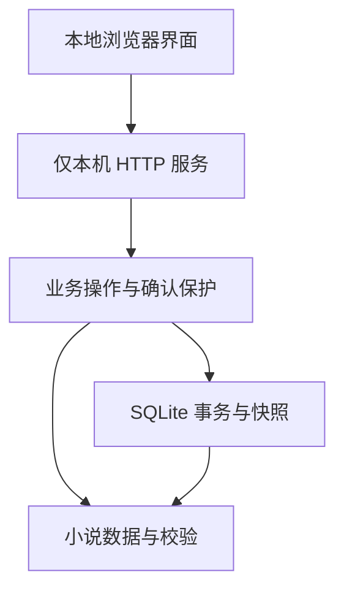

# 模块化架构

2026-10-15当前变更：新增全历史迁移/复制、旧JSON、Skills冲突与库外操作收据，沿用三表；专项通过但完整core失败，待独立Astra收口。详见根目录[架构](../ARCHITECTURE.md)与[S2-C交付](s2-c-migration.md)，下方v0.2说明保留历史。

> 本文保留 v0.2 架构的实现说明。2026-10-13 接管后的正式架构现状、专业工作台改造和长期演进方案见根目录 [ARCHITECTURE.md](../ARCHITECTURE.md)，功能范围见 [PRODUCT_REQUIREMENTS.md](../PRODUCT_REQUIREMENTS.md)。下文“后续扩展”为当时建议，当前顺序以 [ROADMAP.md](../ROADMAP.md) 为准。

v0.2 采用 Python 标准库、SQLite 和原生 HTML/CSS/JavaScript 本地界面。对初学者而言，只需要启动一个入口，不用安装前后端框架、数据库服务或模型 SDK。业务、界面和存储独立，后续可替换界面或增加模型适配器。

## 模块职责

| 模块 | 路径 | 职责 | 当前状态 |
|---|---|---|---|
| 领域层 | `src/novel_writer/domain/` | 定义小说数据、状态、关联与版本链约束 | 数据定义与校验已实现 |
| 业务层 | `src/novel_writer/application/` | 创建项目、保存资料、授权正式章节修改、追加版本 | 离线操作可运行，AI 模块预留 |
| 存储层 | `src/novel_writer/storage/` | JSON 转换、SQLite 事务保存、项目快照和 Skills 存储 | 已实现 |
| 界面层 | `src/novel_writer/ui/` | 本机 HTTP 服务、原创界面、作者与 AI 使用指南 | 已实现 |

依赖方向：界面调用业务服务；业务层使用领域数据及注入的存储对象。存储模块使用领域模型解析数据。领域层不导入另外三层。模型调度中心独立预留，当前拒绝所有模型操作。



作者入口为 `start.bat` 或 `run.py`；`scripts/validate_example.py` 是只读示例验证工具。

## 当前目录

```text
AI-Novel-Writer/
├── README.md                       长期目标与当前启动说明
├── AGENTS.md                       开发规范
├── .gitignore                      忽略缓存、实际小说和私人设置
├── pyproject.toml                  项目元信息
├── run.py                          跨平台本地服务入口
├── start.bat                       Windows 双击启动入口
├── docs/                           中文说明
├── src/novel_writer/
│   ├── domain/models.py            数据类与完整文档校验
│   ├── application/                各独立业务模块及 service.py
│   ├── storage/
│   │   ├── json_codec.py           兼容原 schema_version=1
│   │   ├── sqlite_repository.py    项目、事务、保存编号与快照
│   │   └── skills_repository.py    独立 Skills 资料存储
│   └── ui/
│       ├── server.py               HTTP 入口与本机请求保护
│       └── static/                 index.html、app.js、style.css、guide.html
├── data/                          首次启动自动建立，本地数据库，不入 Git
├── examples/sample-novel/          虚构示例与说明
├── scripts/validate_example.py     只读示例校验入口
└── tests/                          数据、存储、业务、Skills、HTTP、启动和浏览器测试
```

## 存储选择与边界

每本小说一个工作区 JSON，内含原小说文档及 IDEA、世界观和文风规则。SQLite 默认存于 `data/novels.sqlite3`，无需安装数据库服务。

每次保存开启数据库事务，更新当前工作区并追加完整项目快照；失败回滚。`revision` 阻止旧窗口覆盖最新保存。章节恢复会追加版本，正式章节修改须明确授权。界面不依赖具体表结构。

这是最小实现，不是百万字规模的最终存储方案。每次保存包含已有正文和版本，完整快照会令数据库增长较快；后续应评估按实体拆表、正文增量存储和快照保留策略，迁移前保护已有历史。

现有校验检查数据类型和关联是否成立，不判断故事质量、人物逻辑或剧情时间线是否合理。例如 `story_time` 目前是作者填写的说明文本，不是自动推理的时间线。

`json_codec.py` 仍负责转换；写入由 `sqlite_repository.py` 处理。已实现本地保存、冲突保护和章节恢复。当前可以导出工作区 JSON 或停止服务后复制数据库备份，备份导入界面尚待实现。

## 18 个独立模块与新增 Skills

以下业务文件位于 `src/novel_writer/application/`，数据库模块位于存储层。手动章节编辑由 `chapters.py` 支持，与模型生成独立。

| 功能 | 文件 | 用途与当前状态 |
|---|---|---|
| 小说项目管理 | `projects.py` | 创建与维护书名、作者、类型和简介，可使用 |
| 全书大纲管理 | `book_outlines.py` | 手动保存主题、故事起点、主线和结局，可使用 |
| 章节细纲管理 | `chapter_outlines.py` | 保存章节核心情节、目标与剧情时间，可使用 |
| 每章 IDEA 管理 | `ideas.py` | 按章节保存独立灵感，可使用 |
| 人物设定管理 | `characters.py` | 创建、改名和编辑人物资料，可使用 |
| 世界观与设定管理 | `worldbuilding.py` | 保存全书背景与规则，可使用 |
| 正文生成模块 | `generation.py` | 预留模型生成能力，待实现 |
| DeepSeek 审核模块 | `deepseek_review.py` | 预留审核建议，待实现 |
| Gemini 修改模块 | `gemini_revision.py` | 预留按审核意见改写，待实现 |
| 小说时间线检查 | `timeline.py` | 预留自动检查，当前只允许手动记录时间 |
| 剧情逻辑检查 | `plot_logic.py` | 预留剧情判断，待实现 |
| 数据库管理 | `storage/sqlite_repository.py` | 事务、冲突检查、项目快照，可使用 |
| 章节版本管理 | `versions.py` | 追加历史、授权检查与恢复，可使用 |
| 全书大纲自动更新 | `outline_updates.py` | 预留自动更新，待实现 |
| 多模型 API 调度中心 | `model_dispatch.py` | 未来统一模型选择、超时与限流，当前拒绝调用 |
| 文风与写作规则管理 | `writing_rules.py` | 保存作者偏好，可使用 |
| 全书质量检查 | `quality.py` | 预留全书检查，待实现 |
| 设置与 API 密钥管理 | `settings.py` | 仅显示离线与环境变量配置状态，部分完成 |
| 本地 Skills 导入 | `skill_import.py` | 导入 Markdown 原文并查看，可使用 |

预留文件包含模块说明和真实状态，不包含虚构检查结果。`service.py` 统一组合模块；软件“模块规划”与这里使用同一套状态描述。

## HTTP 与资料边界

- 服务仅监听 127.0.0.1，每次运行生成随机写入令牌，校验 Host 和 Origin，不开放 CORS。
- 写接口使用 JSON，`POST /api/projects` 创建，`POST /api/projects/{id}/actions` 执行业务操作；冲突为 409、非法输入为 422。
- `GET /api/projects/{id}/export` 导出已保存小说；Skills 使用独立的 `/api/skills` 和 `/api/skills/import`。
- 导入 Skills 只存 Markdown；路径验证、文件数量与大小限制由业务层执行，文字不会作为脚本或 HTML 执行。
- 密钥仅显示“是否配置”的布尔状态，不发给页面、不写入数据库。服务不会请求外部模型。

## 后续扩展

先根据作者实际使用补齐备份导入和章节管理，再逐步实现可替换的模型适配器。模型调用、费用确认和审核调度独立于领域层与界面，完整变更记录和作者确认贯穿各阶段。
